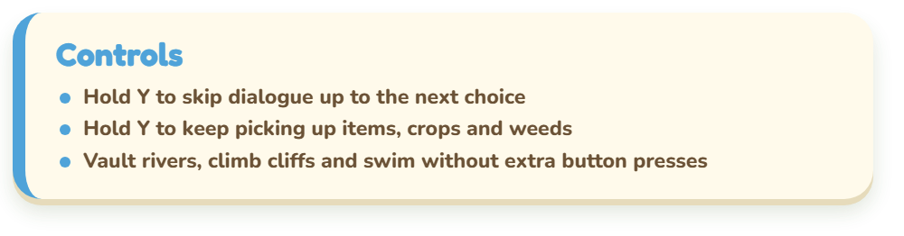
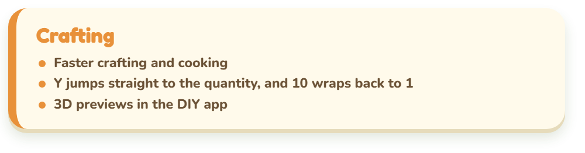
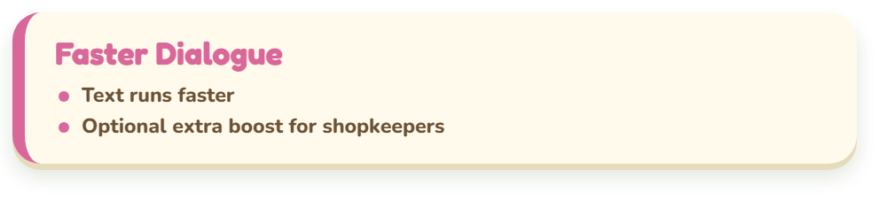
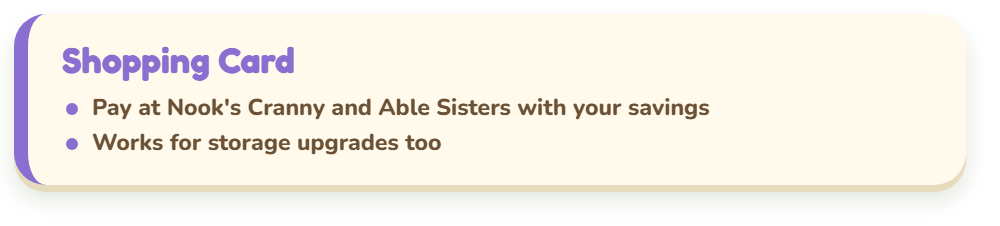
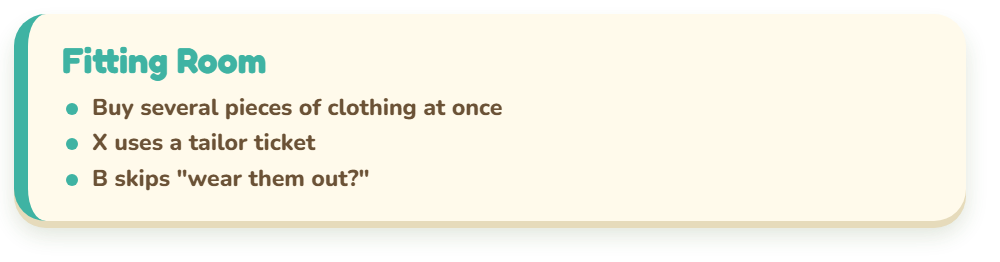
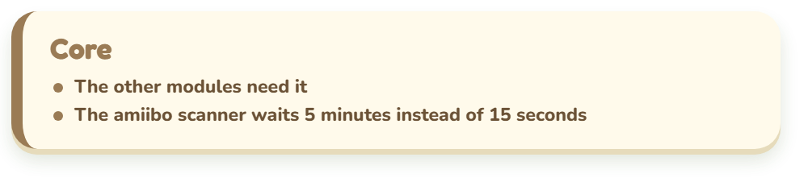

# QoL Enhancements for Peanuts


A port of Arcusaren's [Quality of Life Enhancements](https://gamebanana.com/mods/727637) (v1.1.0, ACNH 3.0.3) so it runs on Peanuts Native on Android.

The normal Switch version doesn't work on Peanuts. It patches the game while it's running, and Peanuts doesn't let plugins do that. This version does the patching ahead of time instead. You don't need a PC or a game dump to install it: there's a [patcher page](https://catmona.github.io/acnh-qol-peanuts/) that builds the mod zip right in your browser.

## Features

All of this is Arcusaren's work, I just got it running on Peanuts. If something doesn't work, please open an issue!










## Install

1. Get **Main download (Modded Switch)** from the mod's [GameBanana page](https://gamebanana.com/mods/727637). Don't unzip it.
2. Get `qol-peanuts-patch.json` from the [latest release](https://github.com/catmona/acnh-qol-peanuts/releases/latest).
3. Open the [patcher page](https://catmona.github.io/acnh-qol-peanuts/), pick both files and hit **Make the Peanuts zip**.
4. In Peanuts, long-press ACNH to open its settings, then go to **Install mod… > Zip file** and pick `qol-enhancements-peanuts.zip`.
5. Peanuts rebuilds the game with the mod. That took about 5 minutes for me. Then hit Play.

Peanuts will put a "A module's hooks will not run" warning on the mod. You can ignore it: the hooks are already baked in.

To remove the mod, hit the trash icon next to it and let Peanuts rebuild. If you turned on clam or trash stacking, turn it off and unstack those first. The comments in `pockets.ini` explain why.


<sub>ACNH-Combined is just another mod I have installed. You don't need it.</sub>

## Settings

These are the same .ini files as the original mod, one per module, in `atmosphere/contents/01006F8002326000/romfs/qol-enhancements/config/` inside the zip. Every option has a comment above it, and `enabled = false` turns a module off. Edit them before you install.

## Troubleshooting

I run it on my AYN Thor with Peanuts Native 0.1.7 and 0.1.8.

On Peanuts 0.1.8, set **Graphics > Frame rate cap** to **Game owned**. With the default 60 fps cap, Peanuts runs its own rewritten copy of the game's code, the mod's hooks never get linked in, and the game crashes at start.

If the patcher says "No Core plugin in that zip" or "This is not QoL Enhancements 1.1.0", you picked the wrong download. You need the Modded Switch one, v1.1.0.

## About the AI part

Heads up: most of this repo (the patcher page, the build tools and the docs) was written by Claude through Claude Code. I decided what to build, picked between the designs it came up with, and okayed every test on my Thor. I haven't gone through the code line by line, and there's no test suite. [PORT.md](docs/PORT.md) lists the checks that were run. Commits don't have a Claude co-author line, so assume any of it could be AI-written. If something's broken, open an issue.

## How it works

The original mod hooks the game by patching its code at run time. Peanuts compiles the game ahead of time, so those patches never land. This port puts the hooks in at build time instead: an IPS patch for the game's `main`, plus a patched copy of the mod's Core plugin. Details are in [PORT.md](docs/PORT.md).

The patch file has the game's original instructions at each hook site in it (604 bytes in all), so it goes in Releases instead of the repo. None of Arcusaren's files are re-hosted here: the page patches your own download.

## Building it yourself

You need Python 3.12, `pip install -r requirements.txt`, the Switch download extracted into `in/switch/`, and the exefs (`main` and `subsdk0`) from your own copy of ACNH 3.0.3.

```
python tools/build.py --exefs <folder with main and subsdk0>
```

That writes the Peanuts zip, the patch file and the IPS to `out/build/`. The other scripts in `tools/` are what I used for the analysis in PORT.md. Each one has its usage at the top.

## Credits

Arcusaren for the actual mod (go give it a like on [GameBanana](https://gamebanana.com/mods/727637)), shadowninja108 for exlaunch, and the Peanuts Native devs.

Fan-made, not affiliated with Nintendo.

## License

GPL-2.0, same as the original mod.
