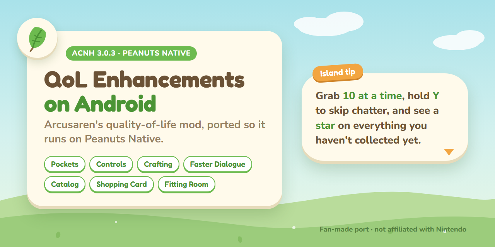
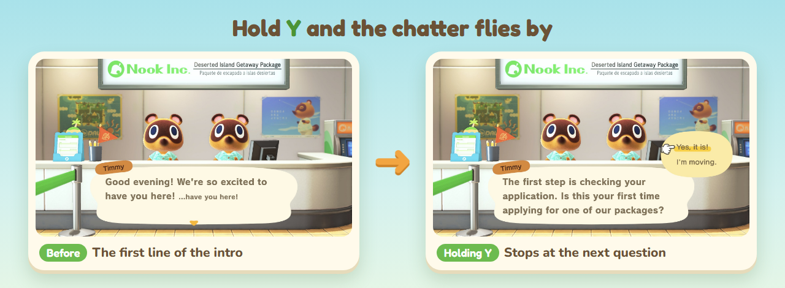
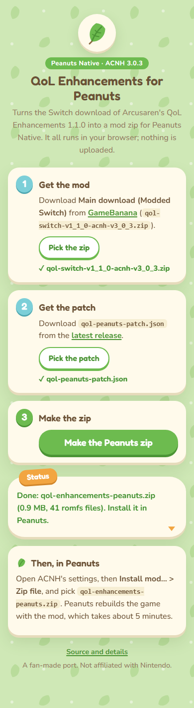

<p align="center">
  
</p>

<p align="center">
  <a href="https://catmona.github.io/acnh-qol-peanuts/"><b>Open the patcher</b></a> ·
  <a href="https://github.com/catmona/acnh-qol-peanuts/releases/latest">Latest release</a> ·
  <a href="https://gamebanana.com/mods/727637">The original mod</a> ·
  <a href="docs/PORT.md">How the port works</a>
</p>

# QoL Enhancements for Peanuts Native

Island life, with fewer button presses. This is Arcusaren's [Quality of Life Enhancements](https://gamebanana.com/mods/727637) 1.1.0 for Animal Crossing: New Horizons 3.0.3, made to work on **Peanuts Native** on Android. Grab 10 items at once, hold Y through long chats, see a star on things you haven't collected yet, pay from your savings at the shops, and more.

The stock mod doesn't work on Peanuts, because Peanuts doesn't let plugins patch the game while it runs. This port puts the mod's hooks in ahead of time. You don't need a game dump or a PC to install it: a web page builds the mod zip on your phone.

<p align="center">
  
  <br><sub>Tested on an AYN Thor: holding Y runs through the dialogue and stops at the next question.</sub>
</p>

> [!NOTE]
> **How this was made.** Most of this repository - the patcher page, the Python build tools and the docs - was written by Claude (Anthropic) through Claude Code, an AI coding assistant. I direct the work: I decide what gets built, choose between the designs it proposes, and approve each test on my own handheld.
>
> **What Claude did:** took apart the mod's Core plugin to find its 151 hooks, designed the port, wrote the tools, the page and the docs, and tested it in an emulator and on my AYN Thor.
> **What I did:** what to build, the design calls, the go-ahead for every device test, and every release.
> **What I have not done:** a line-by-line review of the code. There is no automated test suite; [docs/PORT.md](docs/PORT.md) lists the checks that were run.
>
> Commits here carry no Claude co-author line, so assume any part of the code may be AI-written. Found a bug? Open an issue.

## What you get

Seven feature modules, plus Core, which the others need. Each one can be turned on or off, and most have settings (see [Settings](#settings)).

| Module | What it does | Tried in play on Peanuts |
| --- | --- | --- |
| **Controls** | Hold **Y** to skip dialogue up to the next choice. | ✅ Works |
| | Hold Y to keep picking up items, crops and weeds. Vault rivers and climb cliffs on your own, swim without pressing A, tilt the camera while swimming. | Not yet |
| **Pockets** | Grab 5 or Grab 10 from a stack. ZL to drop or release, ZR to use an item. Hold A to pick several items in shop and storage menus. Y sends items to your home storage. A opens presents and mail without a menu. Optional stacking for Manila clams and fishing trash. | Not yet |
| **Crafting** | Faster crafting, the quantity wraps between 1 and 10, Y jumps straight to the quantity, and the DIY app shows 3D previews. Cooking too. | Not yet |
| **Faster Dialogue** | Text runs faster, with an optional extra boost for shop and service characters. | Not yet |
| **Catalog** | A star on items, recipes, critters and art you haven't collected yet, including in Nook Shopping and the other catalogs. | Not yet |
| **Shopping Card** | Pay at Nook's Cranny, Able Sisters and for storage upgrades from your savings, topped up from your pockets. | Not yet |
| **Fitting Room** | Y adds clothes to a bag so you can buy several at once, X applies a tailor ticket, B skips the "wear them out?" question. | Not yet |
| **Core** | Needed by the rest. Gives the amiibo scanner 5 minutes instead of 15 seconds. | Loads; timer not yet |

"Not yet" means nobody has tried that feature in play on Peanuts so far. It doesn't mean it's broken: all eight modules load with no errors (see [Status](#status)). If you try one, please [open an issue](https://github.com/catmona/acnh-qol-peanuts/issues) and say how it went, and the table gets updated.

## What you need

- **Peanuts Native** on an Android device, with **ACNH 3.0.3** set up and running. Tested with Peanuts Native 0.1.7.
- A browser, on your phone or a PC. Nothing is uploaded: the page does all its work on your device.
- About 10 minutes, most of it waiting for Peanuts to rebuild the game.

## Install



1. **Get the mod.** Download **Main download (Modded Switch)** from the [mod's GameBanana page](https://gamebanana.com/mods/727637). It's a zip named something like `qol-switch-v1_1_0-acnh-v3_0_3.zip`. Leave it zipped.
2. **Get the patch.** Download `qol-peanuts-patch.json` from the [latest release](https://github.com/catmona/acnh-qol-peanuts/releases/latest).
3. **Make the Peanuts zip.** Open the [patcher page](https://catmona.github.io/acnh-qol-peanuts/), pick the mod zip and the patch file, and tap **Make the Peanuts zip**. Your browser saves `qol-enhancements-peanuts.zip`.
4. **Install it in Peanuts.** Long-press ACNH to open its settings, then go to **Install mod… > Zip file** and pick `qol-enhancements-peanuts.zip`.
5. **Build and play.** Peanuts rebuilds the game with the mod, which takes about 5 minutes. Then tap **Play**.

<br clear="right">

After the install, the mod shows up in ACNH's **Game** tab under **Mods**:

<p align="center">
  
</p>

> [!TIP]
> Peanuts shows a warning, **"A module's hooks will not run"**, because the mod looks like a normal exlaunch plugin. You can ignore it: this port puts its hooks in at build time, so they don't need to be added while the game runs. (The other mod in the shot, ACNH-Combined, is a separate mod on the test device. You don't need it.)

### Updating or removing

- **New version:** make a new zip with the new patch file, install it the same way, and let Peanuts rebuild.
- **Remove:** tap the bin next to `qol-enhancements-peanuts` in the Mods list, and let Peanuts rebuild.
- If you turned on Manila clam or fishing trash stacking, turn it off and unstack those items first. The mod's own notes in `pockets.ini` explain why.

## Settings

The settings are the original mod's: one `.ini` file per module, in `atmosphere/contents/01006F8002326000/romfs/qol-enhancements/config/` inside the Peanuts zip. Each file has a comment above every option. For example, in `pockets.ini`:

```ini
# Hold A and move to select/deselect items in selling and shed put-away screens.
enable_multiselect = true
```

To change a setting, edit the file inside the zip before you install it. Every module also has `enabled = true`, which you can set to `false` to turn that module off. Changing settings this way hasn't been tried on Peanuts yet.

## Troubleshooting

- **The patcher page says "No Core plugin in that zip" or "This is not QoL Enhancements 1.1.0".** The page needs the **Modded Switch** download of version 1.1.0, not the emulator download or another version. Pick the zip itself; don't unzip it first.
- **The game crashes.** First turn off your other mods for ACNH in the Mods list and try again, to see which one causes it. Mods made for ACNH 2.x can crash 3.0.3. On the test device, a new game crashed when arriving on the island with an ACNH mod pack that has older 2.x models in it; nothing in the crash pointed at this mod ([details](docs/PORT.md#play-test-ayn-thor-11-24-1214-to-1228-am)).
- **Nothing changed in the game.** Check that the mod is switched on in the Mods list and that Peanuts finished its rebuild after the install.
- **Still stuck?** [Open an issue](https://github.com/catmona/acnh-qol-peanuts/issues) with your Peanuts version and what you saw. If the game crashed, Peanuts offers to share its log; attach that too.

## Status

Tested on an AYN Thor with Peanuts Native 0.1.7:

- Core and all seven modules load with no errors, and the game runs at its normal 30 fps.
- Holding Y to skip dialogue works in play.
- The other features haven't been tried in play yet: the test game crashed at the island arrival, likely because of another mod (see Troubleshooting).

[docs/PORT.md](docs/PORT.md) has the full test notes.

## How it works

The mod hooks the game by patching its code at run time. Peanuts compiles the game ahead of time, so those patches never land. This port puts the hooks in at build time instead: an IPS patch for the game's `main`, plus a patched copy of the mod's Core plugin. [docs/PORT.md](docs/PORT.md) has the details.

The patch file holds the game's original instruction at each hook site (604 bytes in all), so it ships in Releases and not in the repository. Arcusaren's files are never redistributed: the page patches your own download.

## Building the patch yourself

You need Python 3.12, `pip install -r requirements.txt`, the Switch download extracted into `in/switch/`, and the exefs (`main` and `subsdk0`) of your own copy of ACNH 3.0.3.

```
python tools/build.py --exefs <folder with main and subsdk0>
```

This writes the Peanuts zip, the patch file and the IPS to `out/build/`. The other scripts in `tools/` are the analysis tools behind docs/PORT.md; each one has its usage at the top.

## Credits

- **Arcusaren** for QoL Enhancements. All the features are theirs; please support them on [GameBanana](https://gamebanana.com/mods/727637).
- **shadowninja108** for exlaunch.
- **The Peanuts Native authors.**

This is a fan-made port. It is not affiliated with or endorsed by Nintendo, and Animal Crossing is Nintendo's trademark.

## License

GPL-2.0, the same as the original mod.
