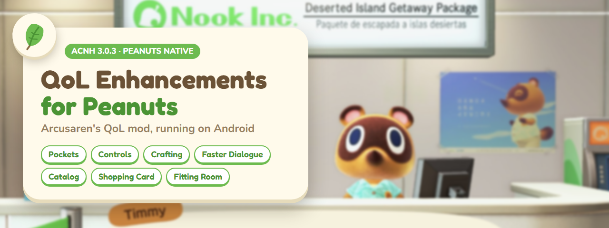
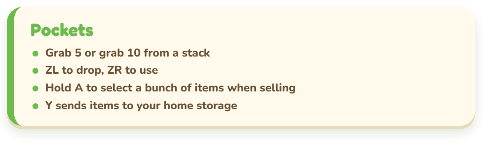
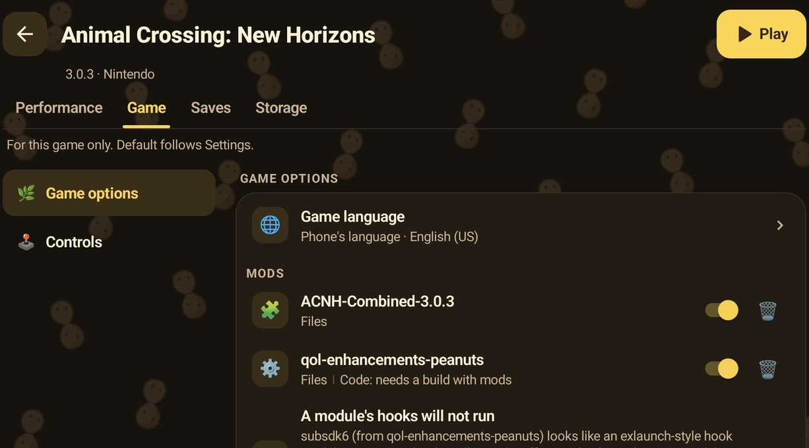

# QoL Enhancements for Peanuts



A port of Arcusaren's [Quality of Life Enhancements](https://gamebanana.com/mods/727637) (v1.1.0, ACNH 3.0.3) so it runs on Peanuts Native on Android. The [patcher page](https://catmona.github.io/acnh-qol-peanuts/) builds it from your own download right in your browser. No PC or game dump needed.

> [!NOTE]
> **How this was made:** Claude (Anthropic's AI, through Claude Code) wrote the patcher page, the build tools and the docs. I decided what to build and tested every build on my AYN Thor, but I haven't reviewed the code line by line, so assume any part of it may be AI-written.

## Features

All of this is Arcusaren's work, I just got it running on Peanuts. If something doesn't work, please open an issue!





## Install

1. Get **Main download (Modded Switch)** from the mod's [GameBanana page](https://gamebanana.com/mods/727637). Don't unzip it.
   Want [Jubbsticks' Additions](https://github.com/catmona/acnh-jubbsticks-peanuts) too? Also get `UJAP-BetaRelease-V002-Atmosphere.7z` from the [port's Releases](https://github.com/dragonloverlord/Unnofficial-Jubbsticks-Additions-Port/releases) (read the rules in its README first). Don't extract it.
2. Open the [patcher page](https://catmona.github.io/acnh-qol-peanuts/), pick your download(s) and hit **Make my Peanuts zips**. The page lists the zips it made, in install order. The first one is the size table.
   Using other mods that change game files, like ACNH Combined? Add them in the other-mods box too, so the size table covers them (see [Size table](#size-table)). Make the zips again after you change your mods.
3. In Peanuts, long-press ACNH, then go to **Mods & Cheats > Add > A file** and add each zip in the order the page lists them, then your other mods. If other romfs mods are already installed, remove them first and add them again after: Peanuts uses the first-installed mod's copy of a file and can't reorder.
4. Peanuts rebuilds the game with the mods. That took about 5 minutes for me. Then hit Play.

One of the zips is a small memory fix. Bigger mods like Jubbsticks' Additions need it, so the page always makes it when you pick the port. With QoL alone you can untick it. It's also in the [latest release](https://github.com/catmona/acnh-qol-peanuts/releases/latest) on its own.

Peanuts shows an "A module's hooks will not run" warning under the mod. You can ignore it: the hooks are already baked in.

To remove the mod, hit the trash icon next to it and let Peanuts rebuild. If you turned on clam or trash stacking, turn it off and unstack those first. The comments in `pockets.ini` explain why.



<sub>My setup. You only need QoL, plus the memory fix if you add bigger mods.</sub>

## Settings

These are the same .ini files as the original mod, one per module, in `atmosphere/contents/01006F8002326000/romfs/qol-enhancements/config/` inside the zip. Every option has a comment above it, and `enabled = false` turns a module off. Edit them before you install.

## Size table

The game keeps a table of how much memory each file may use (`romfs/System/Resource/ResourceSizeTable.srsizetable`) and refuses any file bigger than its entry. QoL's 7 layout files are all bigger than their vanilla 3.0.3 entries. `LBellCounterRT` needs 472,256 bytes, and vanilla allows 77,952. Peanuts uses only one table, the first-installed mod's.

So the page makes one table for every mod you use, as its own small mod (`acnh-size-table-peanuts.zip`) that goes first. The QoL zip has no table. The code and rules are [ACNH RSTB Fixer](https://github.com/catmona/acnh-rstb-fixer)'s (same author), used as a git submodule at `docs/rstb`, so this repo has no copy of them. The page loads `rstb/lib/page.js` and makes one `buildTableMod('peanuts', ...)` call:

1. It starts from vanilla 3.0.3's table, which comes with the patch file. Without QoL (on the Jubbsticks page), it starts from the mods' own tables. Then it adds the tables of every mod you picked (the zips the page made, and the other mods you added), taking the larger size where they differ.
2. It sizes every game file in those mods by the fixer's rules (messages n + 512, texture-only models n + 9,248 + 16 per texture, layouts n + 8,192 + 512, fonts n + 8,192, sound banks n + 712 + 64, data files and flows n + 416 + 32, where n is the file's size rounded up to 32). Each rule matches or beats every vanilla 3.0.3 entry. Entries are only raised, never lowered.
3. A model with geometry loses its entry, so the game sizes it itself. This happens only for models those mods include. QoL has none, so this only comes up with Jubbsticks' Additions or other mods.

A mod you install but didn't add on the page isn't covered: Peanuts uses the table mod's table, so that mod's own raised sizes are lost. Make the zips again after you change your mods. If no table is found anywhere (a patch file from before the table, and no mod with one), the page says so and makes the other zips without one. On a Switch or another emulator, make the table on [ACNH RSTB Fixer's page](https://catmona.github.io/acnh-rstb-fixer/) instead (not online yet): it lays the table out for each of them.

Checked (Nov 26, 2026): `node tools/check_rstb.mjs` builds the QoL zip and the table mod with the page's code and reads the table back out of the zip. Every copy of every file must fit its entry, every geometry model must have none, and no vanilla or mod entry may come out smaller. That passed for QoL alone (7 raised, 64,674 entries) and for QoL with the Jubbsticks zip and ACNH Combined (9 raised, 754 model entries left to the game, 64,596 entries). In headless Chrome the page made the same two zips, byte for byte, in 1.5 s, and showed the folder button on a PC but not on an Android phone.

Not yet checked:
- In game, none of this: no table from the page has been run on the Thor yet, and neither has a table-only mod installed first. The fixer's rebuilt Jubbsticks table passed boot, island load, walking outdoors and the new-save intro (Nov 25), from inside the port's folder. One model with a removed entry has been checked in game, the flimsy fishing rod (Nov 26).
- Adding a mods folder: the page reads it as the fixer's tests do, but no folder was picked in a browser.
- The other removed model entries (fruit, the tool ring and cooking menu, the other wooden tools, pansies, roses, the Roost). The fixer's README lists them.
- Whether the game really refuses QoL's bigger layouts without the table. QoL has run on the Thor without one, but PORT.md doesn't record those screens being opened (the catalog buttons, the tailor and Nook's Cranny counters, the bell counter).

## Troubleshooting

I run it on my AYN Thor with Peanuts Native 0.1.8.

Set **Graphics > Frame rate cap** to **Game owned**. At the default 60 fps cap, Peanuts runs its own rewritten copy of the game's code without the mod's hooks, and the game crashes at start. A one-line Peanuts fix is waiting to be merged. With it, QoL runs at 60 fps, alone or with Jubbsticks' Additions and the memory fix (see [PORT.md](docs/PORT.md)).

At 60 fps, a mod's `Pack/StaticParam.pack` is hidden by Peanuts' own 60 fps copy. With ACNH Combined, that means no river hopping without a pole. `tools/merge_60_pack.py` builds a 60 fps pack that keeps the mod's changes (see [PORT.md](docs/PORT.md#river-hop-at-60-fps-the-variants-romfs-hides-acnh-combineds-pack)).

If the patcher says "No Core plugin in that zip" or "This is not QoL Enhancements 1.1.0", you picked the wrong download. You need the Modded Switch one, v1.1.0.

## How it works

The original mod hooks the game by patching its code while it runs. Peanuts compiles the game ahead of time and doesn't let plugins do that, so those patches never land. This port puts the hooks in at build time instead: an IPS patch for the game's `main`, plus a patched copy of the mod's Core plugin. Details are in [PORT.md](docs/PORT.md).

The page loads its patch file from this site by itself. None of Arcusaren's files are re-hosted here: the page patches your own download.

## Building it yourself

You need Python 3.12, `pip install -r requirements.txt`, the Switch download extracted into `in/switch/`, and the exefs (`main` and `subsdk0`) from your own copy of ACNH 3.0.3.

```
python tools/build.py --exefs <folder with main and subsdk0>
```

That writes the Peanuts zip, the patch file and the IPS to `out/build/`. Add `--rstb <your romfs/System/Resource/ResourceSizeTable.srsizetable>` to put vanilla's size table in the patch file, or add it to an existing patch file with `python tools/add_rstb.py <table> --patch <file>`. The page uses it as the table's base. Without it, the page starts from the mods' own tables, and QoL has none. The zip `build.py` writes has no table: use the page, or ACNH RSTB Fixer on it.

The size table code is the `docs/rstb` submodule. Clone with `git clone --recurse-submodules`, or run `git submodule update --init` in a clone you have. To check the table mod the page makes:

```
node tools/check_rstb.mjs <qol-switch-v1_1_0-acnh-v3_0_3.zip> [--vanilla <table>] [--write <dir>] [jubbsticks-additions-peanuts.zip] [other mods...]
```

To move to a newer fixer, run `git -C docs/rstb pull origin main` and commit the new `docs/rstb`. The other scripts in `tools/` are what I used for the analysis in PORT.md. Each one has its usage at the top.

## Credits

Arcusaren for the actual mod (go give it a like on [GameBanana](https://gamebanana.com/mods/727637)), shadowninja108 for exlaunch, and the Peanuts Native devs.

Fan-made, not affiliated with Nintendo.

## License

GPL-2.0, same as the original mod.
